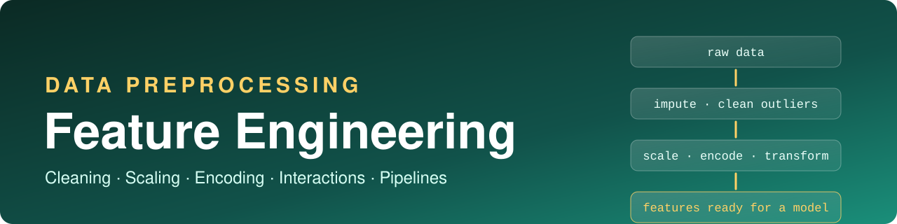

<p align="center">
  <a href="https://www.python.org/"></a>
  <a href="https://scikit-learn.org/"></a>
  <a href="https://pandas.pydata.org/"></a>
  <a href="https://jupyter.org/"></a>
  <a href="https://seaborn.pydata.org/"></a>
  <a href=".github/workflows/notebooks-check.yml"></a>
  
  
</p>

A hands-on feature engineering course in **10 Jupyter notebooks**, all built around one realistic dataset of **50,000 loan applications** with missing values, skewed amounts and a default flag to predict. Each notebook takes one preprocessing step, shows the problem in the data, fixes it, and plots before and after.

> *"Models are only as good as their features: 10 notebooks, 94 code cells, one dataset, every step visualized."*

---

## Course map

| # | Section | Notebooks | What you work on |
|:-:|---------|:---------:|------------------|
| 00 | [Quickstart](00-quickstart/) 🎯 | 1 script | Whole workflow on 5 rows |
| 01 | [Data Cleaning](01-data-cleaning/) 🧹 | 3 | First engineered feature, missing values, outliers |
| 02 | [Feature Transformations](02-feature-transformations/) 🔧 | 3 | Exploration, scaling, categorical encoding |
| 03 | [Advanced Feature Engineering](03-advanced-feature-engineering/) 🚀 | 2 | Skewed-data transforms, feature interactions |
| 04 | [Preprocessing Pipelines](04-preprocessing-pipelines/) 🎯 | 2 | One reusable preprocessing function (v1, v2) |

---

## Learning path

```
 Raw data ──► Clean ──────────► Transform ───────────► Create ────────────► Automate
              missing values    scaling                interactions         preprocess_data()
              outliers (IQR)    encoding               polynomial terms     v1 → v2
              first feature     skew / log             risk-weighted        (+ outliers, VIF)
```

The sections follow the order you would work on a new dataset: understand and clean it, reshape the numbers so models can use them, create new features, then wrap everything into a single reusable function.

---

## Notebook tour

<details>
<summary>🧹 <b>Section 1 — Data Cleaning</b> (3 notebooks)</summary>

| Notebook | What it covers |
|---|---|
| [`feature-engineering-intro.ipynb`](01-data-cleaning/feature-engineering-intro.ipynb) | Build a debt-to-income ratio, then compare model AUC on the original vs engineered features |
| [`lecture-03-handling-missing-values.ipynb`](01-data-cleaning/lecture-03-handling-missing-values.ipynb) | Visualize missing-value patterns with `missingno`, impute columns such as `employment_length` and `credit_score`, validate the imputation with KDE plots |
| [`lecture-04-outlier-detection-iqr.ipynb`](01-data-cleaning/lecture-04-outlier-detection-iqr.ipynb) | Outlier detection with the IQR method |

</details>

<details>
<summary>🔧 <b>Section 2 — Feature Transformations</b> (3 notebooks)</summary>

| Notebook | What it covers |
|---|---|
| [`lecture-02-feature-transformations.ipynb`](02-feature-transformations/lecture-02-feature-transformations.ipynb) | Feature engineering in action: feature categories, correlation heatmap, scatter plots of loan amount vs income by education |
| [`lecture-05-scaling-techniques.ipynb`](02-feature-transformations/lecture-05-scaling-techniques.ipynb) | `StandardScaler`, `MinMaxScaler`, `RobustScaler` and mathematical transformations |
| [`lecture-07-categorical-encoding.ipynb`](02-feature-transformations/lecture-07-categorical-encoding.ipynb) | One-hot encoding, high-cardinality handling, frequency encoding, top-K categories |

</details>

<details>
<summary>🚀 <b>Section 3 — Advanced Feature Engineering</b> (2 notebooks)</summary>

| Notebook | What it covers |
|---|---|
| [`lecture-06-advanced-feature-transformations.ipynb`](03-advanced-feature-engineering/lecture-06-advanced-feature-transformations.ipynb) | Transformations for complex, skewed distributions in financial data, with before/after plots |
| [`lecture-08-feature-interactions.ipynb`](03-advanced-feature-engineering/lecture-08-feature-interactions.ipynb) | Financial ratios, polynomial interactions, risk-weighted features, education × income interactions |

</details>

<details>
<summary>🎯 <b>Section 4 — Preprocessing Pipelines</b> (2 notebooks)</summary>

| Notebook | What it covers |
|---|---|
| [`data-preprocessing-pipeline-v1.ipynb`](04-preprocessing-pipelines/data-preprocessing-pipeline-v1.ipynb) | Load, impute, encode categoricals and scale numerics in one function (loan data) |
| [`data-preprocessing-pipeline-v2.ipynb`](04-preprocessing-pipelines/data-preprocessing-pipeline-v2.ipynb) | Adds outlier handling, log transform, `RobustScaler` and feature selection by variance threshold and VIF (housing data) |

</details>

---

## Featured: does a new feature help?

`feature-engineering-intro` answers the practical question first: engineer one feature (debt-to-income ratio), train the same models with and without it, and compare AUC scores.

| Dimension | Detail |
|-----------|--------|
| **Dataset** | [`data/loan_applications.csv`](data/loan_applications.csv): 50,000 applications × 17 columns, target `default` (28.8% positive) |
| **Messy on purpose** | Missing `employment_length`, `income`, `credit_score`, `existing_loans`; see the [data dictionary](data/README.md) |
| **Second dataset** | [`data/Housing.csv`](data/Housing.csv): 545 houses, used by pipeline v2 |

<details>
<summary>📈 Sample from <code>01-data-cleaning/feature-engineering-intro.ipynb</code></summary>

```python
# 🔥 1. Function to Create Debt-to-Income Ratio
# =============================================

def create_debt_to_income(df):
    """
    Creates a new feature: Debt-to-Income Ratio (DTI).

    Formula:
        DTI = (monthly_payment * 12) / income

    Parameters:
    df (pd.DataFrame): Input dataframe containing 'monthly_payment' and 'income' columns.

    Returns:
    pd.DataFrame: Updated dataframe with 'debt_to_income' column.
    """
    df['debt_to_income'] = (df['monthly_payment'] * 12) / df['income']

    # Handle infinite and NaN values
    df['debt_to_income'] = df['debt_to_income'].replace([np.inf, -np.inf], np.nan)
    df['debt_to_income'] = df['debt_to_income'].fillna(df['debt_to_income'].mean())

    return df


# 🔥 Apply the function
df = create_debt_to_income(df)
```

</details>

---

## Repository layout

```
Feature-Engineering/
├── 00-quickstart/                   # whole workflow on 5 rows (script)
├── 01-data-cleaning/                # one folder per course section,
├── 02-feature-transformations/      #   each with its own README
├── 03-advanced-feature-engineering/
├── 04-preprocessing-pipelines/
├── data/                            # loan_applications.csv, Housing.csv
├── assets/                          # README banner
├── .github/                         # CI
└── requirements.txt
```

**Why a single `main`?** This repo used to keep every part on its own branch, and the datasets on yet another one. Everything now lives on `main`, and the original branch history is preserved in the commit graph.

---

## Quick start

```bash
git clone https://github.com/evgeniimatveev/Feature-Engineering.git
cd Feature-Engineering
uv venv && uv pip install -r requirements.txt   # or: python -m venv .venv && pip install -r requirements.txt
jupyter lab
```

Open a notebook from its own folder. The notebooks read the data with `../data/...`, which is where Jupyter's working directory points by default.

---

## Continuous integration

Every push and pull request runs [`notebooks-check.yml`](.github/workflows/notebooks-check.yml):

| Check | What it catches |
|-------|-----------------|
| **Validate every `.ipynb`** | Broken or corrupted notebook files |
| **Widget metadata** | Notebooks GitHub would show as "Invalid Notebook" |
| **File-name hygiene** | Spaces in file names |
| **Quickstart script** | `hello_feature_engineering.py` still runs |
| **Datasets present** | The two CSV files exist and are not empty |

Notebooks are teaching material, so they are **not** executed on every push. A second workflow, [`notebooks-run.yml`](.github/workflows/notebooks-run.yml), is **manual**: Actions → *Notebook run (manual)* → *Run workflow*. It runs all 10 notebooks top to bottom and writes a pass/fail table to the Job Summary.

---

## Known limitations

- The notebooks load data with relative paths (`../data/...`). In Google Colab, clone the repo first (`!git clone ...`) and open the notebook from the cloned folder.
- Outputs saved inside the notebooks come from the original runs, so numbers can differ slightly from a fresh run (random splits, library versions).
- `lecture-06` sits in section 3 because that is where the original branch put it, although its number comes earlier in the course.

---

## Tech stack

`Python` · `pandas` · `NumPy` · `scikit-learn` · `SciPy` · `statsmodels` · `Matplotlib` · `Seaborn` · `Jupyter` · `GitHub Actions`

---

*Built by [Evgenii Matveev](https://github.com/evgeniimatveev) · Data Analyst / Analytics & MLOps Engineer*
